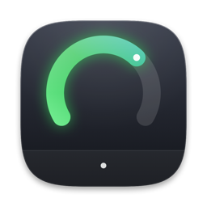

<p align="center"></p>

# Docklet

一款 macOS 常驻小组件，仿照 Dockset 的形态：**在 Dock 内部占一格**，实时显示 AI 编程工具的额度。

当前支持 **GitHub Copilot** 与 **OpenAI Codex**，各占一格，看起来就像 Dock 自带的图标。

> Claude Code 额度功能已停用并从菜单中隐藏（`AppDelegate.isClaudeFeatureAvailable = false`）。启动时 Docklet 会移除自己注册过的 statusline，不读取钥匙串。下文中关于 Claude 的说明仅供恢复该功能时参考。

## 它是怎么"长在 Dock 里"的

macOS 的 Dock 没有插件接口，所以唯一能在 Dock *内部*占位的办法是：

1. 往 `com.apple.dock` 的 `persistent-apps` 里插入 `spacer-tile` 空白格，让 Dock 自己腾出空间
2. 用一个**完全透明**的窗口精确覆盖这些空白格 —— 不画任何背景，直接透出 Dock 自己的毛玻璃材质
3. 通过辅助功能 API 读取这些空白格的实时坐标，跟随 Dock 的位置、大小与放大动画

因此视觉上它不是"贴在旁边的飞地"，而是 Dock 的一部分。空白格可以像图标一样**拖到 Dock 任意位置**。

## 特性

- **原生观感**：圆环直径按单个 Dock tile 的短边推算，随系统「Dock 大小」滑块与鼠标放大自动缩放；环心对齐 Dock 的格栅，与相邻图标间距一致
- **三个数据源**：Copilot、Codex、Claude 各占一格（未安装的自动隐藏，也可在菜单中关闭）
- **口径对齐官方**：显示「已用」百分比，与 GitHub 自己的 `70% used` 一致；可在菜单里切换为剩余百分比 / 剩余数量
- **颜色预警**：剩余 <25% 转橙，<10% 转红
- **详情面板**：点击任一环弹出，分区列出两个来源的全部配额、重置日期与数据时间
- **菜单栏镜像**：全屏应用下也能查看；可在「设置…」（⌘,）中关闭
- **零配置登录**：Copilot 的 Token 依次尝试 钥匙串 → 环境变量（`DOCKLET_GITHUB_TOKEN` / `GH_TOKEN` / `GITHUB_TOKEN`）→ `gh auth token` → `~/.config/gh/hosts.yml`

## 数据从哪来

| 来源 | 方式 | 新鲜度 |
| --- | --- | --- |
| Copilot | `api.github.com/copilot_internal/user`（官方编辑器插件所用接口） | 每 60 秒拉取 |
| Codex | 读取 Codex 自己写的会话记录 `~/.codex/sessions/*.jsonl` | 你上次使用 Codex 时 |
| Claude | ① `api.anthropic.com/api/oauth/usage`，使用钥匙串中 Claude Code 的登录；② 备用：Claude Code 的 statusline 写入的 `~/.docklet/claude-usage.json` | ① 每 60 秒；② 你上次使用 Claude Code CLI 时 |

Codex 之所以读本地文件而非调接口：ChatGPT 后端有反爬保护（直连返回 403），而且"为了查还剩多少额度而发一次请求"本身就会消耗额度。OpenAI 在响应头里返回限额，Codex 每轮都会记录到本地 —— 这是同一份官方数据，零网络开销、不需要凭据。代价是新鲜度，所以详情面板里明确标注了数据采集时间。

Claude 优先取实时额度：Docklet 读取 Claude Code CLI 存在钥匙串里的登录（服务名 `Claude Code-credentials`，首次会弹出钥匙串授权，选「始终允许」），向 Anthropic 查询 5 小时 / 7 天用量，与桌面版和网页版显示的一致。Docklet **只读不刷新**这份登录 —— 刷新会轮换 refresh token，可能把 CLI 挤下线；登录过期后面板会提示，在终端运行一次 `claude` 即可恢复。

备用来源是 statusline：Claude Code 只把套餐额度（`rate_limits`）交给 statusline 命令。Docklet 启动时，若 `~/.claude/settings.json` 中还没有 `statusLine`，会先备份为 `settings.json.docklet-backup`，再注册 `~/.docklet/claude-statusline.sh`。该脚本调用 `Docklet --claude-statusline` 记录额度，并在 Claude Code 底部显示一行「模型 · 5h x% · 7d y%」。如果你已配置自己的 statusline，Docklet 不会覆盖，只在面板中提示。菜单中关闭「显示 Claude 额度」时会移除 Docklet 的 statusline；卸载 Docklet 后该脚本会自动变成空操作。

Codex 和 Claude 的记录一旦超过重置时间，会自动视为已重置（已用 0%），直到下次使用时刷新为真实值。

## 构建

需要 macOS 14+ 与 Swift 5.9+。

```bash
./scripts/create_signing_identity.sh   # 只需执行一次，见下方说明
INSTALL=1 ./scripts/build_app.sh       # 构建并安装到 /Applications
open /Applications/Docklet.app
```

应用图标由 `swift scripts/make_icon.swift <输出目录>` 生成（再用 `iconutil -c icns` 打包为 `Resources/AppIcon.icns`）。

### 为什么要自签名证书

macOS 把辅助功能授权绑定到代码签名上。ad-hoc 签名（`codesign -s -`）**每次重建都会产生新的 cdhash**，于是授权每次都失效，要反复重新勾选。`create_signing_identity.sh` 会生成一枚持久的自签名证书，签名要求变成绑定证书而非哈希，授权一次即可长期有效。

> 构建产物写在 `~/Library/Caches/DockletBuild`，避免 SwiftPM 的 SQLite 数据库落在 iCloud/OneDrive 同步目录里触发 I/O 错误。

## 首次运行

1. 授予**辅助功能**权限（系统设置 → 隐私与安全性 → 辅助功能），勾选 `/Applications/Docklet.app`
   - 授权后无需重启，组件会自动吸附到位
   - 未授权时降级为悬浮在 Dock 旁边，功能不受影响
2. 菜单里选择**「在 Dock 中创建嵌入位」**，确认后 Dock 会重启一次并腾出空格
3. 若没装 `gh` 或未登录，菜单里选**「设置 GitHub Token…」**，Token 会存入钥匙串

## 交互

| 操作 | 效果 |
| --- | --- |
| 左键点击某个环 | 打开/关闭额度详情 |
| 右键点击 | 打开菜单 |
| 点击别处 / Esc | 关闭详情 |
| 菜单栏 ✦ 图标 | 同一套菜单（可在设置中隐藏） |
| 菜单栏隐藏时再次打开 Docklet | 弹出设置窗口 |

## 排障

```bash
/Applications/Docklet.app/Contents/MacOS/Docklet --diagnose    # 权限、Dock 几何、Token 来源、Codex / Claude 数据
/Applications/Docklet.app/Contents/MacOS/Docklet --dump-dock   # 打印 Dock 的完整辅助功能树
DOCKLET_TRACE=1 /Applications/Docklet.app/Contents/MacOS/Docklet   # 记录面板几何变化到 $TMPDIR/docklet-trace.log
```

修改 Dock 配置前建议先备份：`defaults export com.apple.dock ~/dock-backup.plist`

## 代码结构

```
Sources/Docklet/
  AppDelegate.swift              入口、菜单栏、菜单命令
  SettingsWindowController.swift 设置窗口（是否显示菜单栏图标）
  QuotaFeed.swift                数据源协议与详情面板的数据模型
  QuotaMonitor.swift             Copilot：轮询官方接口
  CopilotQuota.swift             Copilot 数据模型
  CodexMonitor.swift             Codex：轮询本地会话记录
  CodexUsage.swift               Codex 数据模型与解析
  ClaudeMonitor.swift            Claude：实时额度 + statusline 快照，取较新者
  ClaudeLiveUsage.swift          Claude：用钥匙串中的 CLI 登录查询实时额度
  ClaudeUsage.swift              Claude 快照读写、statusline 命令与安装
  TokenStore.swift               Token 解析与钥匙串存取
  PanelController.swift          无边框面板、跟随 Dock、弹簧平滑、弹窗管理
  DockSlotTracker.swift          缓存 spacer 的辅助功能引用，支持逐帧低成本读取
  DockAnchor.swift               Dock 整体几何与权限
  DockSpacerManager.swift        插入/移除 Dock 空白占位格
  TileStackView.swift            沿 Dock 轴向排布各个 tile
  WidgetContentView.swift        单个 tile 的绘制（环、数字、按压反馈）
  WidgetState.swift              tile 的一帧渲染数据
  Spring.swift                   Apple 参数化弹簧（response / dampingRatio）
  QuotaDetailViewController.swift 详情弹窗
  Diagnostics.swift / Trace.swift 排障工具
```

## 设计要点

- **弹簧而非固定动画**：额度变化、按压反馈、跟随 Dock 放大全部由临界阻尼弹簧驱动，随时可打断，且从当前呈现值继续
- **跟随策略**：鼠标靠近时以显示刷新率跟随 Dock 放大动画，离开并静止后降到 0.6 秒低频；动画期间禁止全树重扫（一次重扫是 100+ 次跨进程调用，会成为可见卡顿）
- **几何弹簧**：Dock 会在点击前后瞬时关闭再打开放大，逐帧硬跟随会表现为抖动；用快速临界阻尼弹簧吸收这类往返，同时保持与邻近图标同步
- **字号一致性**：数字字号按固定参照串 `100` 计算，避免三位数时缩小一档、显得比旁边的两位数更细
- **深色外观**：Dock 材质在浅色模式下也可能很暗，因此 tile 强制 `vibrantDark`，语义色解析为浅色系

## 后续可扩展

`QuotaFeed` 协议封装了"轮询某处 → 输出一帧可绘制状态"，新增数据源（Claude、Cursor、股价、天气等）只需实现该协议并加入 `feeds` 数组，tile 绘制、详情面板、菜单会自动适配。

## 说明

`copilot_internal/user` 是 GitHub 官方编辑器插件使用的接口，非公开 API，返回结构可能变动。Docklet 对缺失字段做了容错，字段变更时会退化显示而不是崩溃。
